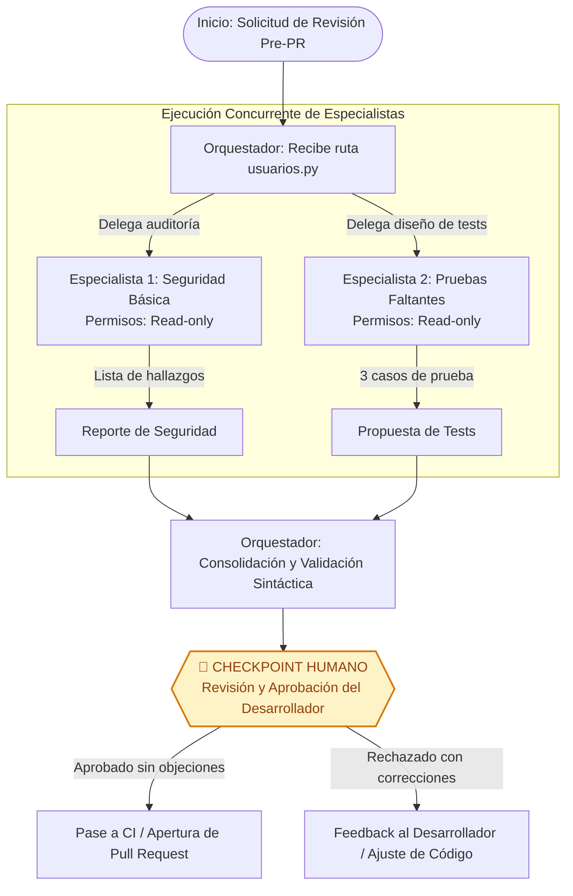

# Diseño del Equipo de Agentes

**Programación Asistida de Aplicaciones · USFQ**  
**Estudiante:** Leandro Crespo (`neanoxd`)  
**Curso:** Deber 6 — Diseña tu equipo de agentes  

---

## Parte 1 — Equipo y Flujo de Trabajo

### Tabla del Equipo de Agentes

La siguiente tabla define las responsabilidades, permisos, entradas, salidas y restricciones operativas de cada miembro del equipo, configurados específicamente para auditar el archivo [`usuarios.py`](file:///usuarios.py) antes de abrir un Pull Request hacia la rama principal:

| Agente | Misión | Herramientas autorizadas | Entrada | Salida | Límites |
|---|---|---|---|---|---|
| **Orquestador** | Coordinar la revisión pre-PR, distribuir el trabajo entre especialistas y consolidar el reporte final | Ninguna propia sobre el código (solo delega tareas a subagentes y sintetiza) | Ruta del archivo (`usuarios.py`) | Tabla Markdown consolidada con hallazgos de seguridad y casos de prueba propuestos | No lee código directamente, no escribe ni modifica archivos del repositorio |
| **Especialista 1 — Seguridad** | Identificar credenciales/tokens hardcodeados y entradas de usuario no validadas o vulnerables | Herramientas de solo lectura y búsqueda (`read_file`, `grep_search`) | Ruta exacta del archivo (`usuarios.py`) | Lista estructurada: línea de código, problema técnico identificado y severidad (`Crítica`, `Alta`, `Media`, `Baja`) | Restringido exclusivamente al archivo [`usuarios.py`](file:///usuarios.py); prohibida la escritura, edición o ejecución de código |
| **Especialista 2 — Pruebas** | Analizar la lógica de negocio y proponer 3 casos de prueba esenciales que faltan | Herramientas de solo lectura (`read_file`) | Ruta exacta del archivo (`usuarios.py`) | Lista estructurada: nombre del caso de prueba, qué verifica, entradas propuestas y resultado esperado | Solo propone casos de prueba; prohibido generar o escribir archivos de test o modificar el código |

---

### 1. Diagrama del Flujo de Trabajo

Los dos especialistas son completamente independientes entre sí: ninguno requiere la salida del otro para completar su labor. Por lo tanto, el orquestador delega las tareas en paralelo, unifica sus respuestas en un reporte tabular y somete el resultado a un **checkpoint humano obligatorio** antes de cualquier decisión de merge o ejecución.



---

### 2. Checkpoint Humano: Criterios de Aprobación y Rechazo

El checkpoint humano es la barrera de control donde el desarrollador o revisor humano evalúa el informe consolidado antes de habilitar el flujo de integración continua:

#### ¿Qué mira la persona antes de aprobar?
1. **Verosimilitud y existencia real de las líneas señaladas:** Comprueba en el editor que la línea 10 (`API_KEY`), la línea 11 (`ADMIN_PASSWORD`) y la línea 21 (concatenación SQL) realmente contengan el código vulnerable reportado y no sean alucinaciones del modelo.
2. **Severidad y pertinencia contextual:** Evalúa si la severidad asignada refleja el riesgo real (por ejemplo, calificar como crítica la inyección SQL en `buscar_usuario` y como media la falta de validación de formato en `crear_usuario`).
3. **Calidad técnica y viabilidad de los casos de prueba:** Verifica que los 3 casos propuestos por el Especialista 2 cubran escenarios críticos de borde (ej. payload SQL `' OR '1'='1`, valores de descuento superiores al 100% o precios negativos, y correos electrónicos con sintaxis rota).
4. **Ausencia de modificaciones colaterales:** Confirma mediante `git status` que ninguno de los subagentes haya alterado [`usuarios.py`](file:///usuarios.py) ni otros archivos de configuración.

#### ¿Qué la haría rechazar el reporte?
- **Falsos positivos flagrantes o alucinación de líneas:** Si el especialista reporta una vulnerabilidad en una línea que no existe (ej. "Línea 84: buffer overflow") o cita funciones ajenas al archivo analizado.
- **Casos de prueba redundantes, triviales o destructivos:** Si el Especialista 2 propone casos que ya están cubiertos, casos sin sentido semántico (ej. "probar qué pasa si Python no tiene memoria") o sugiere pruebas que ejecuten comandos en el sistema operativo.
- **Omisión de riesgos críticos evidentes:** Si el Especialista 1 pasa por alto que [`usuarios.py`](file:///usuarios.py) concatena parámetros en una consulta SQL directa (`"SELECT * FROM usuarios WHERE nombre = '" + nombre + "'"`).
- **Invasión de límites:** Si algún especialista intentó invocar herramientas de escritura o solicitó alterar dependencias.

---

### 3. Detección de Fallos y Acciones del Orquestador

El orquestador implementa mecanismos de control para detectar anomalías en las respuestas de los especialistas:

| Patrón de Fallo | Detección por el Orquestador | Acción Correctiva del Orquestador |
|---|---|---|
| **Salida vacía o trunca** | El subagente retorna un string vacío, nulo o de longitud menor a un umbral mínimo de tokens sin completar la estructura esperada. | **Reintento inmediato (Retry con backoff):** El orquestador relanza la petición al subagente especificando un recordatorio de que debe inspeccionar [`usuarios.py`](file:///usuarios.py) y completar el formato. Si vuelve a fallar tras 2 reintentos, marca al especialista como no disponible y escala la alerta al checkpoint humano. |
| **Alucinación de líneas o código inexistente** | El orquestador ejecuta una validación rápida cruzada (comprobando que el número de línea esté en el rango 1 a 43 y que el fragmento coincida con el contenido del archivo). | **Petición de autocorrección (Correction prompt):** El orquestador le devuelve al subagente el mensaje: *"El número de línea reportado excede las 43 líneas de usuarios.py. Vuelve a examinar el archivo usando únicamente las líneas reales."* |
| **Violación de límites (intento de escritura o análisis de archivos ajenos)** | El harness intercepta llamadas a herramientas prohibidas (`write_file`, `edit_file`, comandos de shell) o rutas fuera de [`usuarios.py`](file:///usuarios.py). | **Bloqueo y aislamiento:** El harness deniega la llamada a nivel de sandbox. El orquestador aborta la ejecución de ese subagente, descarta su salida y genera una advertencia de seguridad en el reporte final para conocimiento del revisor humano. |
| **Formato incompatible o no parseable** | El subagente responde con prosa conversacional desordenada en lugar de la lista con los campos requeridos (`Línea`, `Problema`, `Severidad`). | **Normalización estructurada:** El orquestador solicita un formateo estricto o extrae los campos clave mediante un parser de expresiones regulares antes de consolidar la tabla. |

---

## ## A2A — Descubrir y Delegar a un Agente Remoto

En este escenario de diseño arquitectónico, el **Especialista 2 (Pruebas Faltantes)** deja de ser un script o subagente local y pasa a ser un **agente autónomo remoto**, operado por un equipo especializado en Quality Assurance en un servidor independiente bajo el protocolo A2A (Agent-to-Agent).

### 1. Agent Card Ilustrativa

La siguiente es la tarjeta de capacidades (Agent Card) expuesta por el agente remoto de pruebas. Anuncia su identidad, descripción, interfaces disponibles, capacidades operativas y requisitos de seguridad:

> *Simplificación didáctica; no es JSON conforme a una versión específica de A2A.*

```json
{
  "agent_id": "agent://qa-specialists.agente.ejemplo/test-generator",
  "name": "Agente Generador de Casos de Prueba QA",
  "version": "1.2.0",
  "description": "Agente remoto autónomo especializado en análisis estático de código fuente, identificación de rutas no probadas y generación declarativa de casos de prueba unitarios y de borde.",
  "provider": {
    "organization": "QA Automation Services S.A.",
    "contact": "soporte-agentes@agente.ejemplo",
    "domain": "agente.ejemplo"
  },
  "endpoints": {
    "a2a_interface": "https://agente.ejemplo/api/a2a/v1/tasks",
    "status_query": "https://agente.ejemplo/api/a2a/v1/tasks/{task_id}",
    "events_stream": "https://agente.ejemplo/api/a2a/v1/tasks/{task_id}/events"
  },
  "skills": [
    {
      "id": "skill:propose-missing-tests",
      "name": "Propuesta de Casos de Prueba Faltantes",
      "description": "Analiza código Python y retorna una lista de hasta N casos de prueba esenciales con entradas y resultados esperados.",
      "input_schema": {
        "type": "object",
        "properties": {
          "file_name": { "type": "string" },
          "file_content": { "type": "string" },
          "max_test_cases": { "type": "integer", "default": 3 },
          "test_framework": { "type": "string", "enum": ["unittest", "pytest"] }
        },
        "required": ["file_name", "file_content"]
      },
      "output_schema": {
        "type": "object",
        "properties": {
          "test_cases": {
            "type": "array",
            "items": {
              "type": "object",
              "properties": {
                "nombre_caso": { "type": "string" },
                "que_verifica": { "type": "string" },
                "entradas_sugeridas": { "type": "string" },
                "resultado_esperado": { "type": "string" }
              },
              "required": ["nombre_caso", "que_verifica"]
            }
          }
        }
      }
    }
  ],
  "capabilities": {
    "streaming": true,
    "async_task_execution": true,
    "human_in_the_loop_prompts": true
  },
  "security": {
    "auth_scheme": "Bearer",
    "token_issuer": "https://auth.agente.ejemplo/oauth2/token",
    "required_scopes": ["a2a:tasks:create", "a2a:tasks:read"],
    "tls_version": "TLS 1.3",
    "data_retention_policy": "ephemeral_no_store"
  }
}
```

---

### 2. Dónde se Obtiene la Tarjeta y Validaciones del Cliente

#### Punto de descubrimiento
El cliente (nuestro orquestador) obtiene la Agent Card a través de uno de los siguientes mecanismos estandarizados:
1. **Well-Known URI estándar:** Petición HTTPS directa a `https://agente.ejemplo/.well-known/agent-card.json`.
2. **Registro centralizado de agentes de la organización:** Consulta a un catálogo corporativo de agentes de confianza donde se almacenan y verifican las tarjetas públicas.

#### Validaciones previas que realiza el cliente antes de interactuar:
- **Validación de origen y certificado:** Verifica que el dominio `agente.ejemplo` cuente con TLS válido, certificado no revocado y correspondencia con el emisor confiable.
- **Coincidencia de skill:** Comprueba que la lista `skills` incluya la habilidad requerida (`skill:propose-missing-tests`) y que los esquemas de entrada (`input_schema`) y salida (`output_schema`) coincidan con los datos de [`usuarios.py`](file:///usuarios.py).
- **Compatibilidad de interfaz y versión:** Verifica que el protocolo de comunicación (REST/JSON-RPC sobre HTTPS) y las versiones de la API sean compatibles.
- **Requisitos de autenticación y autorización:** Constata si se requiere un token OAuth2/Bearer, valida que el orquestador posea los scopes requeridos (`a2a:tasks:create`) y que las políticas de retención de datos garanticen confidencialidad (`ephemeral_no_store`).

---

### 3. Secuencia de Comunicación A2A

El flujo de delegación remota entre el orquestador local y el agente de pruebas sigue la siguiente secuencia:

```text
[Orquestador Local]                     [Agente Remoto A2A (agente.ejemplo)]
         |                                                 |
         |---- 1. GET /.well-known/agent-card.json ------->|
         |<--- 2. Retorna Agent Card (JSON) ---------------|
         |                                                 |
    [Valida origen, skill,                                 |
     esquemas y seguridad]                                 |
         |                                                 |
         |---- 3. POST /tasks (payload: usuarios.py) ----->|
         |<--- 4. HTTP 202 Accepted (Task ID: tk-889) -----|  * (O HTTP 200 directo si es síncrono)
         |                                                 |
         |---- 5. GET /tasks/tk-889 (Polling / SSE) ------>|
         |<--- 6. Estado: "working" (Progreso: 60%) -------|
         |                                                 |
         |---- 7. Notificación / GET final --------------->|
         |<--- 8. Estado: "completed" + Artifact (Tests) --|
```

> **Aclaración clave:** Una solicitud A2A **no siempre crea una Task asíncrona**. Si la tarea es ligera (como proponer 3 casos sobre un archivo de 43 líneas) y el agente cuenta con baja latencia, puede responder de inmediato con un mensaje `HTTP 200 OK` conteniendo el resultado. La creación de una `Task` con ciclo de vida es mandatoria cuando la tarea requiere razonamiento prolongado, ejecución en segundo plano o pasos interactivos.

---

### 4. Ciclo de Vida de Estados y Caso Alternativo

#### Flujo simplificado:
1. `submitted`: La tarea fue recibida por el agente remoto, validada sintácticamente y encolada en su scheduler de ejecución.
2. `working`: El agente remoto asignó recursos, analizó las funciones de [`usuarios.py`](file:///usuarios.py) y está generando los casos de prueba.
3. `completed`: El análisis culminó satisfactoriamente y el artefacto con los 3 casos de prueba estructurados está disponible para descarga.

#### Caso alternativo: Estado `input-required` o `failed`
- **Si el agente entra en `input-required`:**
  - *Causa:* El agente remoto requiere una aclaración antes de continuar (por ejemplo: *"¿Prefiere aserciones de tipo `pytest` con fixtures o `unittest.TestCase` tradicional?"*).
  - *Acción del cliente:* El cliente orquestador lee la especificación de la pregunta enviada en el estado de la Task, consulta su configuración predeterminada (o solicita input al usuario en la consola si es necesario) y emite un `POST /tasks/{id}/input` con la respuesta: `{"test_framework": "pytest"}`. La Task regresa a `working`.
- **Si el agente entra en `failed`:**
  - *Causa:* Error interno en el LLM remoto, superación del tiempo límite (timeout) o payload corrupto.
  - *Acción del cliente:* El cliente captura el código de error (`TASK_TIMEOUT` o `INTERNAL_ANALYSIS_ERROR`), evita que el pipeline se congele, registra el fallo en la bitácora y aplica una política de resiliencia: reintento único o delegación a un agente de fallback secundario. Si no hay alternativa, marca el fallo en la tabla consolidada para que el checkpoint humano decida si continuar manualmente.

---

### 5. Comparativa: Subagente Local vs. Agente Remoto A2A y Diferencia con MCP

| Dimensión | Subagente Local (Harness actual) | Agente Remoto A2A |
|---|---|---|
| **Interfaz de comunicación** | Llamadas internas en memoria, CLI o sistema de archivos del harness (`.gemini/agents/`, `.claude/agents/`). | Protocolo de red estandarizado (HTTP/HTTPS, JSON-RPC, SSE o gRPC). |
| **Descubrimiento** | Archivos estáticos locales en carpetas del proyecto. No hay negociación dinámica. | Dinámico a través de Agent Cards publicadas en `/.well-known/agent-card.json` o registros corporativos. |
| **Interoperabilidad** | Acoplado a la herramienta de código específica (cada harness define su formato YAML/TOML propio). | Universal e independiente de proveedor: un orquestador en Gemini CLI puede dialogar con un agente en Python/FastAPI o LangGraph. |
| **Límites de confianza** | Confianza implícita en el entorno de ejecución local. El aislamiento depende del proceso anfitrión. | **Zero Trust:** Requiere autenticación mTLS/OAuth, firma criptográfica, validación estricta de esquemas y políticas de privacidad de datos. |

#### Diferencia fundamental entre A2A y MCP:
- **MCP (Model Context Protocol):** Conecta a **un agente con herramientas pasivas y fuentes de datos** (por ejemplo, servidores MCP que permiten leer un archivo en disco, consultar una base de datos Postgres o invocar una API de cálculo). En MCP, la herramienta no razona: solo ejecuta una función determinista o expone un recurso.
- **A2A (Agent-to-Agent):** Conecta a **un agente con otro agente autónomo**. El agente remoto receptor tiene su propio ciclo de razonamiento, capacidad de planificar, descomponer problemas, gestionar estados (`working`, `input-required`) y devolver artefactos cognitivos.

> **Regla de decisión arquitectónica:** Si el orquestador necesita leer directamente [`usuarios.py`](file:///usuarios.py) o consultar el historial de Git, utiliza una herramienta local o un servidor **MCP**. Si el orquestador necesita encomendar una auditoría intelectual autónoma de pruebas a un especialista independiente en otro servidor, utiliza **A2A**. La elección se basa en la autonomía requerida y la frontera arquitectónica, no en la acción básica de acceder a archivos.
