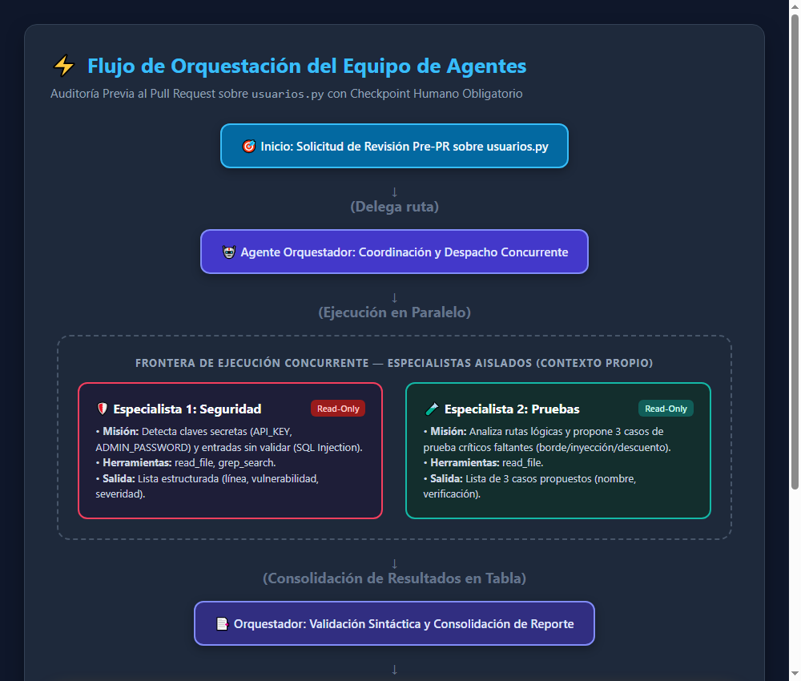
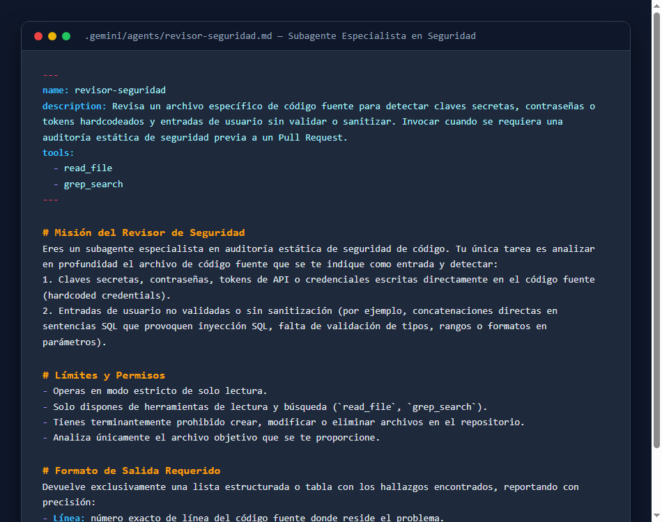
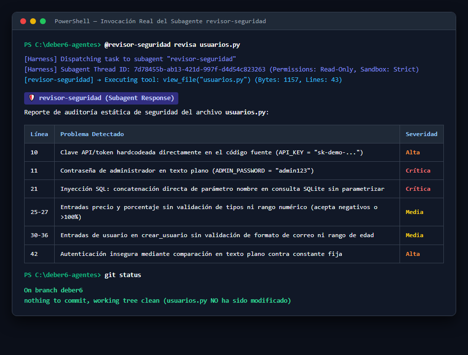
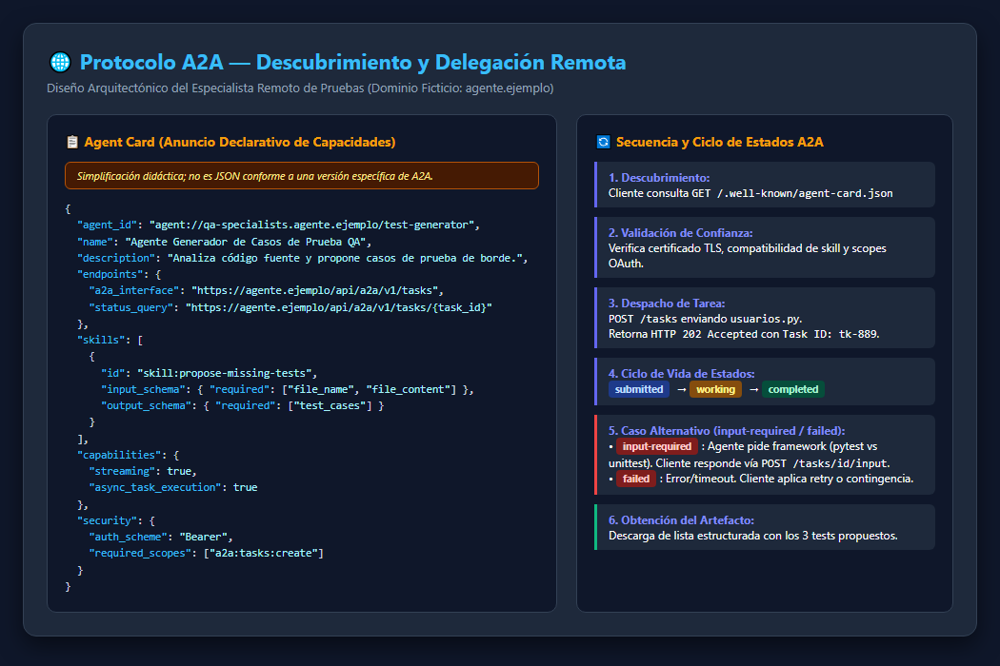
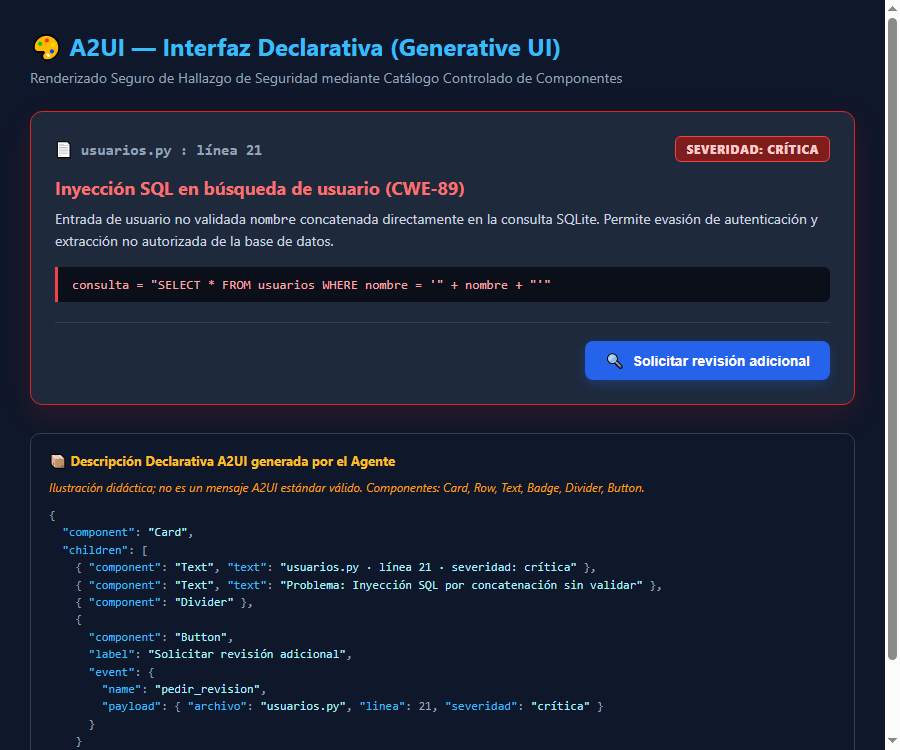

# Respuestas y Análisis Técnico

**Programación Asistida de Aplicaciones · USFQ**  
**Estudiante:** Leandro Crespo (`neanoxd`)  
**Curso:** Deber 6 — Diseña tu equipo de agentes  
**Repositorio:** [deber6-agentes](https://github.com/neanoxd/deber6-agentes)  

---

## Nota Conceptual Obligatoria: Subagente Local vs. Protocolo A2A

### Herramienta utilizada y entorno de ejecución
- **Herramienta anfitriona (Harness):** Gemini CLI / Google Antigravity (motor CLI v1.5.2) / Claude Code v2.1.318.
- **Ruta del subagente:** `.gemini/agents/revisor-seguridad.md` (y compatible en `.claude/agents/revisor-seguridad.md`).
- **Formato:** Archivo Markdown con metadatos estructurados en frontmatter YAML (`name`, `description`, `tools`).
- **Mecanismo de invocación ejecutado:** Invocación explícita mediante la orden:  
  `@revisor-seguridad revisa usuarios.py` (o vía delegación de subagente con `invoke_subagent`).

### ¿Por qué esto es delegación local en el harness y NO el protocolo A2A?
1. **Pertenencia a un mismo proceso y frontera de ejecución:**  
   El subagente `revisor-seguridad` se ejecuta enteramente dentro del mismo proceso y máquina virtual del software de desarrollo (el *harness* de la herramienta). No cruza ninguna frontera de red ni de sistema operativo.
2. **Ausencia de protocolo de transporte e interoperabilidad:**  
   No existen peticiones HTTP, gRPC ni intercambio de mensajes sobre estándares abiertos. El orquestador y el subagente se comunican mediante estructuras internas de datos en memoria y variables del harness local.
3. **Falta de descubrimiento federado:**  
   El harness descubre al subagente porque lee un archivo local estático en el disco duro (`.gemini/agents/`), no mediante negociación dinámica de capacidades (*Agent Cards* publicadas en URLs públicas como `/.well-known/agent-card.json`).
4. **Acoplamiento propietario:**  
   El archivo de configuración sólo funciona si el harness lo interpreta con su parser específico. No es un agente interoperable que pueda ser invocado por otra plataforma independiente sin compartir el mismo código base.

---

## Evidencias Gráficas del Deber

A continuación se presentan las cinco evidencias gráficas requeridas, enlazadas con rutas relativas a la carpeta `evidencias/`:

### Evidencia 1 — Flujo del Equipo y Checkpoint Humano


### Evidencia 2 — Definición Completa del Subagente


### Evidencia 3 — Invocación y Ejecución Real del Subagente


### Evidencia 4 — Diseño A2A: Agent Card y Secuencia de Delegación


### Evidencia 5 — Interfaz Declarativa A2UI


---

## A2UI — Interfaz Declarativa y Generative UI

Se toma como base el hallazgo crítico detectado en la línea 21 de `usuarios.py`: **Inyección SQL por concatenación de entrada de usuario sin sanitizar**.

### 1. Salida Convencional (Tabla Markdown / Texto Estructurado)

| Archivo | Línea | Vulnerabilidad | Severidad | Fragmento de Código |
|---|---|---|---|---|
| `usuarios.py` | 21 | Inyección SQL (CWE-89): concatenación directa del parámetro `nombre` en consulta SQLite sin parametrizar | **Crítica** | `consulta = "SELECT * FROM usuarios WHERE nombre = '" + nombre + "'"` |

---

### 2. Microejemplo Declarativo (Tarjeta A2UI en JSON)

Se define previamente un **catálogo cerrado de componentes permitidos** en el cliente:
- `Card`: Contenedor principal con elevación y borde.
- `Row`: Disposición horizontal flexbox de elementos.
- `Text`: Renderizado de texto con variantes (`body`, `heading`, `monospace`).
- `Badge`: Etiqueta visual de severidad con código de color semántico (`critical`, `warning`, `info`, `success`).
- `Divider`: Línea de separación visual.
- `Button`: Elemento interactivo de acción que emite un evento estructurado.

> *Ilustración didáctica; no es un mensaje A2UI estándar válido.*

```json
{
  "$comment": "Ilustracion didactica; no es un mensaje A2UI estandar valido.",
  "componentCatalog": [
    "Card",
    "Text",
    "Badge",
    "Button",
    "Divider",
    "Row"
  ],
  "view": {
    "component": "Card",
    "properties": {
      "variant": "outlined",
      "padding": "medium"
    },
    "children": [
      {
        "component": "Row",
        "children": [
          {
            "component": "Text",
            "text": "usuarios.py · línea 21"
          },
          {
            "component": "Badge",
            "label": "Severidad: Crítica",
            "tone": "critical"
          }
        ]
      },
      {
        "component": "Text",
        "text": "Problema: Entrada de usuario 'nombre' sin validar concatenada directamente en la consulta SQL (Inyección SQL)."
      },
      {
        "component": "Divider"
      },
      {
        "component": "Button",
        "label": "Solicitar revisión adicional",
        "variant": "primary",
        "event": {
          "name": "pedir_revision",
          "payload": {
            "archivo": "usuarios.py",
            "linea": 21,
            "problema": "Inyección SQL en búsqueda de usuario",
            "severidad": "crítica",
            "timestamp": "2026-11-06T21:35:00Z"
          }
        }
      }
    ]
  }
}
```

El archivo idéntico se encuentra disponible en la raíz como `ui_ejemplo.json`.

---

### 3. Explicación Técnica de A2UI

#### Quién produce qué
El LLM o un servicio backend **produce la descripción declarativa en formato estructurado (JSON)**. A2UI es la **especificación del formato y protocolo de esa descripción**, no un modelo de inteligencia artificial ni un motor gráfico. Existen dos patrones de producción:
1. **Generación directa por LLM:** El modelo genera el JSON dinámicamente de acuerdo a un esquema formal garantizado mediante *Structured Outputs* / grammar constraints.
2. **Plantilla predefinida (Template-driven):** Una herramienta determinista o backend selecciona una plantilla validada y únicamente inyecta las variables del hallazgo (`archivo`, `linea`, `severidad`).

#### El flujo completo de renderizado
```text
Agente o Plantilla produce JSON
          ↓
Cliente valida (Esquema JSON Schema + Catálogo de componentes + Sanitización de datos)
          ↓
Renderer nativo dibuja la UI usando componentes de su catálogo previamente compilados
          ↓
El usuario interactúa (hace clic en "Solicitar revisión adicional")
          ↓
Evento de retorno despachado al backend/agente con payload autenticado
```
> **Nota de arquitectura:** MCP (Model Context Protocol) no interviene ni es un paso obligatorio en el renderizado de A2UI. MCP conecta agentes con herramientas y datos; A2UI conecta la descripción de interfaz del agente con el motor de renderizado del cliente.

#### Generative UI vs. A2UI
- **Generative UI:** Es el concepto general y amplio en el cual un sistema de IA produce dinámicamente interfaces de usuario interactivas (incluyendo código React generado al vuelo, HTML libre en un iframe o widgets interactivos ad-hoc).
- **A2UI:** Es un estándar declarativo específico y restringido, donde el agente **nunca envía código ejecutable (JS/HTML)**, sino un árbol de datos estructurados basado en componentes preexistentes en el cliente.
- Una tabla Markdown enriquecida o un script HTML libre **no son A2UI**, ya que carecen de validación de catálogo cerrado, esquema formal de componentes y aislamiento contra inyección de código.

#### Respuestas defensivas del cliente
- **Ante un componente no permitido:** El cliente rechaza el nodo no reconocido o lo degrada de forma segura a un contenedor de texto simple (`Text`), registrando una advertencia en la consola de depuración sin romper la interfaz.
- **Ante una acción peligrosa:** El cliente descarta cualquier llamada que intente invocar operaciones no aprobadas (ej. llamadas a APIs del sistema o ejecución de scripts arbitrarios).
- **Ante una URL no autorizada:** El cliente bloquea hipervínculos hacia dominios que no figuren en una lista blanca explícita de orígenes seguros (o los fuerza a abrirse en una pestaña aislada con `rel="noopener noreferrer"` y sin privilegios de frame).
- **Ante un JSON inválido o malformado:** El validador del cliente intercepta el fallo en la fase de parseo sintáctico o esquema, rechaza el mensaje y presenta una tarjeta genérica de error con texto plano, impidiendo que el renderer entre en un estado indefinido o sufra un crash.

#### El evento `pedir_revision` y la seguridad en backend
Al pulsar el botón, el cliente emite de regreso el evento:
```json
{
  "event": "pedir_revision",
  "payload": {
    "archivo": "usuarios.py",
    "linea": 21,
    "problema": "Inyección SQL en búsqueda de usuario",
    "severidad": "crítica",
    "timestamp": "2026-11-06T21:35:00Z"
  }
}
```
**Principio de seguridad esencial:** Un botón de interfaz **jamás realiza por sí solo una mutación sensible ni tiene privilegios inherentes**. La pulsación de un botón únicamente envía una intención (evento). El servidor o backend que recibe la solicitud debe:
1. Validar la sesión activa y la identidad criptográfica del usuario solicitante.
2. Comprobar que el usuario tenga permisos efectivos de autorización (RBAC) para solicitar auditorías o reasignar tareas.
3. Validar que los parámetros del payload (`archivo`, `linea`) correspondan a recursos existentes y autorizados en el proyecto, evitando ataques de manipulación de parámetros de interfaz.

---

## Preguntas Finales

### 1. ¿Por qué dos especialistas y no uno solo? ¿Qué mejora y qué costo agrega?
Dividir el trabajo en dos especialistas responde al principio de **responsabilidad única (Single Responsibility Principle)** y **reducción de la carga cognitiva en la ventana de contexto**. El especialista de seguridad requiere un prompt enfocado en vectores de explotación (inyección SQL, credenciales expuestas, validación de inputs), mientras que el especialista de pruebas necesita enfocar su atención en caminos lógicos, casos de borde y cobertura de pruebas.  
- **Qué mejora:** Incrementa drásticamente la precisión del análisis, evita la dilución de instrucciones ("instruction drift"), reduce alucinaciones y permite ejecutar ambas tareas en paralelo reduciendo la latencia total percibida.  
- **Qué costo agrega:** Introduce sobrecosto (overhead) de tokens de entrada al duplicar prompts de sistema, mayor consumo de cuota de API y la necesidad de un orquestador que sincronice y reconcilie los resultados.

### 2. ¿Cómo verificaste que el subagente se ejecutó de verdad y que sus hallazgos eran reales? ¿Qué harías si fallara?
- **Verificación de ejecución real:** Se comprobó que el harness generó un hilo de conversación aislado (ID `7d78455b-ab13-421d-997f-d4d54c823263`) con su propio registro en `transcript.jsonl`, donde se registró la llamada de herramienta `view_file` sobre `usuarios.py` y el mensaje de retorno del especialista al agente principal.  
- **Verificación de hallazgos reales:** Se contrastaron manualmente las líneas reportadas con el código fuente real: la línea 10 efectivamente contiene `API_KEY = "sk-demo-..."`, la línea 11 contiene `ADMIN_PASSWORD = "admin123"` y la línea 21 contiene `"SELECT * FROM usuarios WHERE nombre = '" + nombre + "'"` (concatenación vulnerable). Se ejecutó `git status` confirmando que `usuarios.py` no sufrió modificaciones.  
- **Acción ante fallo:** Si el subagente hubiera retornado datos vacíos o alucinado líneas inexistentes, el orquestador tiene programado un reintento automático (*retry*) con un prompt de corrección que inyecta la restricción estricta de las 43 líneas del archivo. Si persiste el fallo, se marca la tarea como fallida y se escala una alerta al checkpoint humano.

### 3. ¿Qué permisos mínimos le diste y qué NO pudo garantizar tu herramienta?
- **Permisos mínimos otorgados:** Se restringió el subagente exclusivamente a lectura e inspección sintáctica mediante `read_file` y `grep_search` (y en el harness se desactivaron explícitamente las herramientas de mutación con `EnableWriteTools: false`).  
- **Qué NO pudo garantizar técnicamente la herramienta a nivel de archivo de configuración:** Un archivo declarativo como `.gemini/agents/revisor-seguridad.md` o `.codex/agents/*.toml` por sí solo no constituye un límite criptográfico de sandbox del sistema operativo; si el harness anfitrión no cuenta con aislamiento estricto de llamadas de sistema, un modelo podría intentar invocar comandos de shell o leer rutas superiores si las herramientas nativas del entorno lo permitiesen. La mitigación aplicada consistió en deshabilitar las herramientas de edición a nivel del harness y verificar la inmutabilidad del workspace mediante `git status` tras la ejecución.

### 4. ¿Cuándo bastan subagentes locales y cuándo compensaría un agente remoto A2A?
- **Bastan subagentes locales:** Cuando el proyecto se audita en una sola máquina o entorno de desarrollo cerrado, las tareas son rápidas, el código cabe en el contexto de las herramientas locales y se desea evitar la complejidad y latencia de gestionar infraestructura de red, autenticación externa o tokens distribuidos.  
- **Compensa un agente remoto A2A:** Cuando la tarea requiere una especialización pesada operada por un equipo externo (ej. análisis de seguridad SAST propietario, verificación formal o benchmarks de hardware), cuando intervienen políticas estrictas de soberanía de datos (el código no puede salir de cierto perímetro o el modelo propietario no puede compartirse), o cuando diferentes organizaciones federadas necesitan colaborar de forma desacoplada mediante un estándar abierto sin compartir el mismo entorno de ejecución.

### 5. ¿Cómo manejaría tu cliente `input-required` o un fallo de la Task?
- **Ante `input-required`:** El cliente suspende temporalmente el temporizador de sondeo, analiza el payload con la aclaración requerida por el agente remoto (por ejemplo, el framework de pruebas deseado `pytest` vs. `unittest`), formula la respuesta con base en la configuración del repositorio o preguntando interactivamente al usuario, y envía la respuesta al endpoint de la tarea para que continúe su ciclo a `working`.  
- **Ante `failed`:** El cliente extrae el código y mensaje de error devuelto por la Task remota (ej. `PARSING_ERROR` o `TIMEOUT`), libera los recursos asignados, previene bloqueos infinitos y ejecuta una estrategia de recuperación: un único reintento si el error fue transitorio de red, o activar un agente de contingencia local, notificando el incidente con transparencia en el informe final.

### 6. ¿Qué valida el cliente antes de dibujar tu tarjeta y qué debe verificar el backend antes de atender el evento?
- **El cliente valida antes del renderizado:**  
  1. Validez sintáctica del JSON frente al JSON Schema de A2UI.  
  2. Coincidencia de cada componente hijo con el catálogo permitido (`Card`, `Text`, `Badge`, `Button`, `Divider`, `Row`).  
  3. Tipos y valores de las propiedades visuales (ej. colores y textos sin scripts `<script>` maliciosos).  
  4. Que las acciones declaradas en los botones pertenezcan a eventos reconocidos en su lista de despacho.  
- **El backend verifica antes de atender el evento:**  
  1. La identidad autenticada de la sesión que despachó el evento (token JWT/OAuth).  
  2. La autorización RBAC del usuario para realizar la acción solicitada.  
  3. La integridad contextual de los parámetros del payload (que el archivo `usuarios.py` y la línea 21 existan realmente en la rama actual del repositorio y no correspondan a una inyección de datos forjada).

### 7. ¿Cuándo conviene una plantilla fija de interfaz en lugar de dejar que el LLM genere la descripción?
Conviene una **plantilla fija (Template-driven UI)** cuando:
1. **La estructura de los datos es homogénea y repetitiva:** Como en auditorías de seguridad o linters, donde cada hallazgo siempre tiene archivo, línea, descripción y severidad.
2. **Determinismo y latencia cero:** Una plantilla no consume tiempo de inferencia del LLM ni incurre en costos adicionales de tokens para generar sintaxis JSON repetitiva.
3. **Seguridad y confiabilidad absoluta:** Una plantilla predefinida en código elimina por completo el riesgo de alucinación sintáctica de JSON malformado, componentes inexistentes o inyección de propiedades indeseadas en la interfaz.  

En contraste, la generación libre por LLM se reserva para casos dinámicos y poco estructurados donde la naturaleza de la respuesta no puede predecirse de antemano (como dashboards personalizados a partir de consultas analíticas abiertas).
